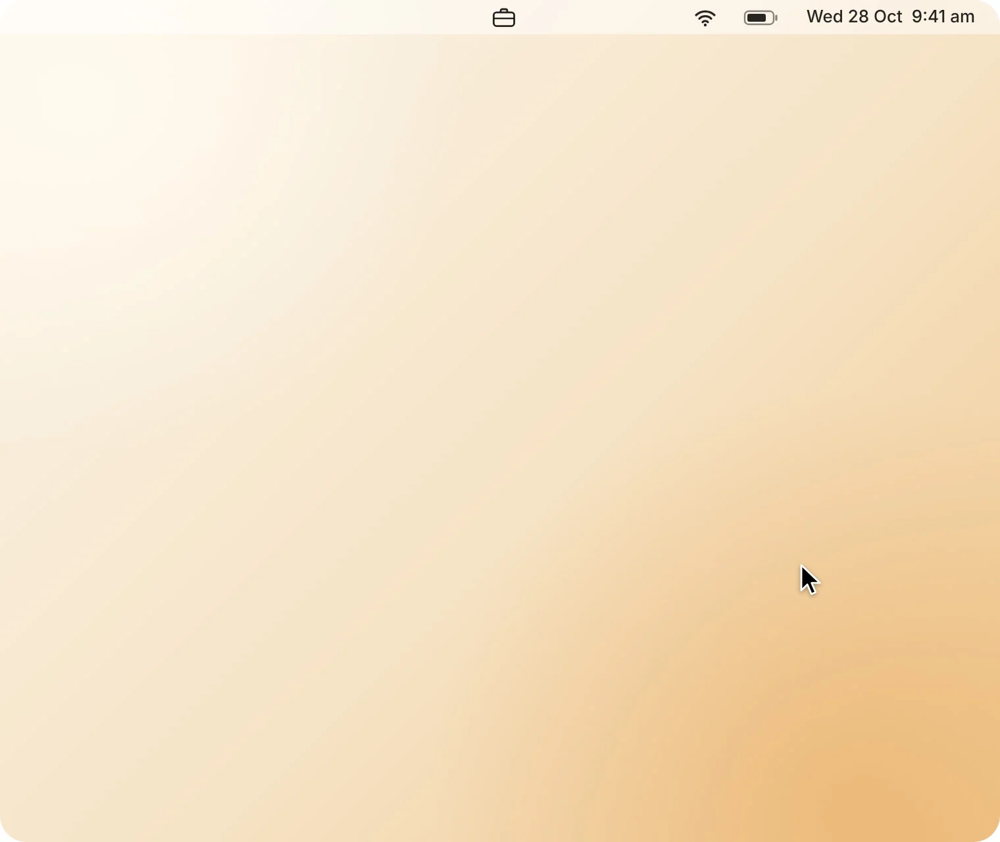

<h1 align="center">WorkLog </h1>

<p align="center">
  Counts the days you work outside your contract, using your git commits as proof.
</p>

<p align="center">
  <a href="https://github.com/Sir-Monke/WorkLog/releases/latest"></a>
  
  
</p>

<p align="center">
  <picture>
    <source media="(prefers-color-scheme: dark)" srcset="docs/demo-dark.webp">
    
  </picture>
</p>

## Install

1. Download **[WorkLog.zip](https://github.com/Sir-Monke/WorkLog/releases/latest/download/WorkLog.zip)** and unzip it.
2. Open **WorkLog**. It moves itself into Applications, starts at login and lives in your menu bar.
3. Choose the folder with your repos and notes. Your git name and email are filled in for you.

## What it does

- **Finds your work.** Checks your repos and notes every 10 minutes for commits and edited files.
- **Counts extra days.** Any day outside your contracted days with work on it, with the gross pay.
- **Writes the notes.** One line per day from Claude Code, or type your own.
- **Ready for Slack.** Copies the month as plain text in one click.
- **Keeps history safe.** Past months lock, a new day rate only applies from the day you set it, and a day you remove stays removed.

## Settings

Click the gear in the panel.

| Setting | What it does |
| --- | --- |
| Work folder | Where your repo clones and notes live |
| Git name or email | Whose commits count |
| Contracted days | Your normal working days; any other day you work is extra |
| Count from | The first day to count |
| Day rate | Gross pay per extra day, in your currency |

## Privacy and AI notes

Everything stays on your Mac. If [Claude Code](https://claude.com/claude-code) is installed and signed in, WorkLog asks Haiku for a one-line note per day, sending only commit messages, file names and note titles, never code. No API key needed. Without Claude Code, notes come from your commit messages.

## Build from source

Open `WorkLog.xcodeproj` in Xcode and run. To check the logic:

```sh
/Applications/WorkLog.app/Contents/MacOS/WorkLog --selftest
```

## Licence

[MIT](LICENSE)
