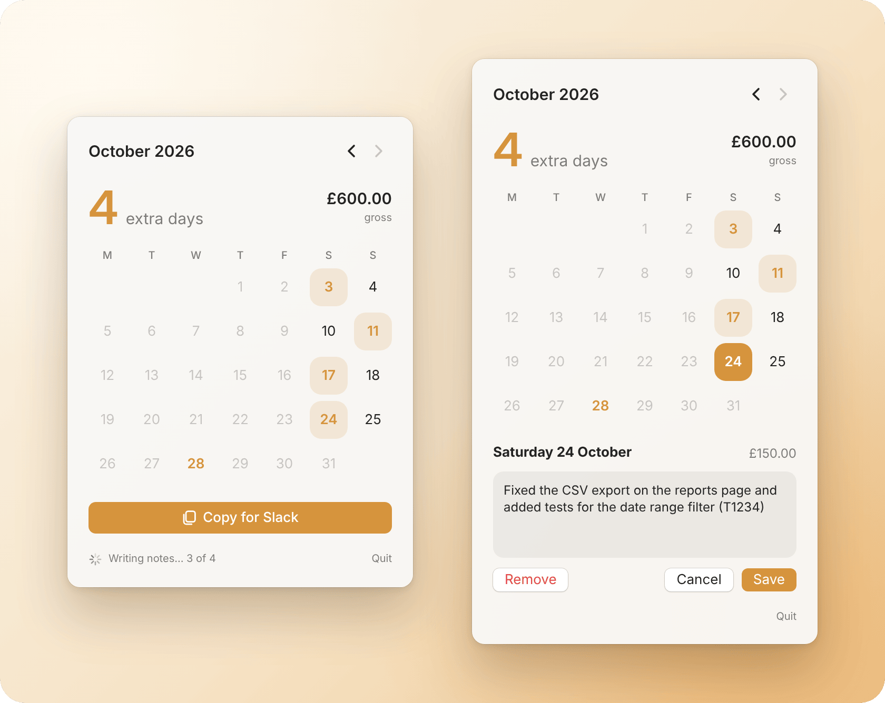

<h1 align="center">WorkLog </h1>

<p align="center">
  A macOS menu bar app that counts the days you work outside your contract, using your git commits and file edits as proof.
</p>

<p align="center">
  
  
  
</p>

<p align="center">
  <picture>
    <source media="(prefers-color-scheme: dark)" srcset="docs/hero-dark.png">
    
  </picture>
</p>

## What it does

- **Finds your work.** Scans your repos and notes folder every 10 minutes for commits and edited files.
- **Counts extra days.** Marks them on a month calendar and totals the gross pay.
- **Writes the notes.** One line per day from Claude Code, or type your own.
- **Ready for Slack.** Copies the month as plain text in one click.
- **Keeps history safe.** Past months lock, and a day you remove stays removed.

## Setup

1. Open `WorkLog.xcodeproj` in Xcode.
2. Set these at the top of `WorkLog.swift`:

   | Setting | What it is |
   | --- | --- |
   | `root` | Folder with your repo clones and notes |
   | `myAuthors` | Your git author name or email |
   | `contractStart` | Date to start counting from |
   | `contractedWeekdays` | Your normal working days (Sunday = 1) |
   | `dayRates` | Your gross day rate, from a given date |

3. Run. WorkLog copies itself into Applications, opens from there and starts at login.

## AI notes

Optional. If [Claude Code](https://claude.com/claude-code) is installed and signed in, WorkLog asks Haiku for a one-line note per day. It only sends commit messages, file names and note titles, never code. No API key needed.

## Self-test

```sh
/Applications/WorkLog.app/Contents/MacOS/WorkLog --selftest
```

History is saved to `history.json` in `root/WorkLog/`.
